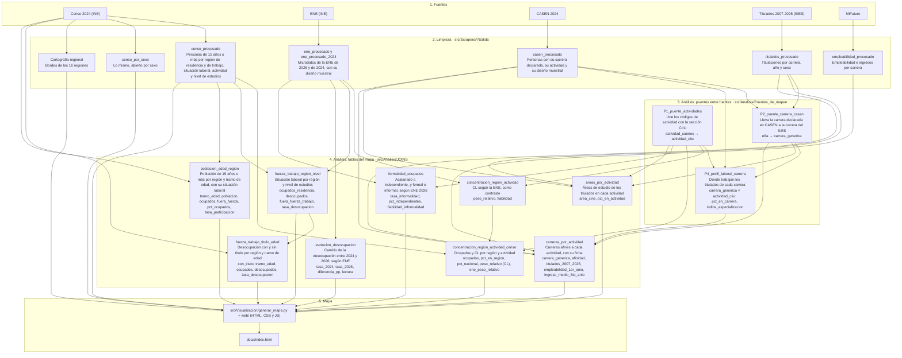

# Mapa Laboral de Chile

> Un mapa interactivo para entender en minutos dónde se trabaja en Chile, en qué, con qué estudios y en qué condiciones.
> Cruza el Censo 2024 y cuatro fuentes oficiales más, y solo muestra cifras medidas, cada una con su fuente.

## Por qué existe este proyecto

Nació para responder una pregunta concreta: **¿qué probabilidad tiene de encontrar trabajo quien estudia una carrera, en cada región de Chile?**

Al revisar los datos, esa pregunta resultó no medible:

- Las fuentes con región (el Censo y la Encuesta Nacional de Empleo, ENE) no registran qué carrera estudió cada persona.
- Las que tienen carrera son nacionales. El registro de títulos (SIES) anota la región de la sede donde se estudió, no la del trabajo.
- La única que tiene ambas, la encuesta CASEN, no tiene muestra suficiente: de **3.040** combinaciones de carrera y región, solo **62** son fiables en ocupados y **0** en desocupados.
- Ninguna fuente mide la demanda de trabajo por carrera, así que ni siquiera a nivel nacional había una probabilidad.

Llenar ese vacío con una estimación habría supuesto la misma mezcla de carreras en todas las regiones. Por eso el proyecto cambió de pregunta y muestra solo lo que sí se mide: el trabajo por región con el Censo y la ENE, y el vínculo entre carreras y actividades a nivel nacional.

## Cómo verlo

- **En línea:** [enlace-github-pages] *(se agrega al publicar en GitHub Pages)*.
- **Sin internet:** descarga [`docs/index.html`](docs/index.html) y ábrelo en el navegador. Es un solo archivo de **479 KB**, sin servidor ni dependencias.
- **Enlaces directos:** cada vista tiene su propio enlace. Por ejemplo, `index.html#B/2` abre Minería en Antofagasta y baja a su detalle. El botón "atrás" del navegador vuelve a la vista anterior.


*Vista inicial: principales hallazgos, el mapa, la lista de regiones y el resumen, donde cada sección se titula con su hallazgo. Cada región se pinta con la actividad que más la distingue frente a Chile. Un color más suave indica que esa actividad pesa entre 1,2 y menos de 1,6 veces lo que pesa en Chile, es decir, también más que en el país.*

**Coeficiente de localización (CL):** cuánto pesa una actividad en una región comparado con lo que pesa en todo Chile. Un CL de 1 es igual que en Chile, y uno de 1,29 indica un peso 29% mayor. Es el indicador que colorea el mapa.

## ¿Qué puedes explorar en el mapa?

- **¿Dónde se concentra cada actividad económica?** Elige una de las 20 actividades y el mapa colorea cada región según su CL.
- **¿Cómo es el trabajo en cada región?** Hombres y mujeres, nivel de estudios y desocupación, siempre frente a Chile.
- **¿Ayuda tener un título?** Desocupación e informalidad con y sin título técnico o profesional, también a igual edad.
- **¿Qué se estudió para trabajar en cada actividad?** El área de estudio de sus titulados y las carreras afines.
- **¿Cómo le va a cada carrera?** Una ficha con sus titulados, empleabilidad e ingresos.

<details>
<summary>Qué muestra cada vista</summary>

- **Vista inicial:** resume la población y las 20 actividades, con un gráfico de hombres y mujeres y otro de la región donde más pesa cada una. Incluye también el área de estudio de los titulados de cada actividad y la formalidad del trabajo. Tiene un índice de secciones, y cada una se titula con su hallazgo.
- **Al elegir una actividad,** el mapa colorea cada región según su CL.
- **Al elegir una región,** el detalle va por tema:
  - **El CL:** la tabla de la actividad y el CL de las 20 actividades de la región, en escala logarítmica.
  - **Hombres y mujeres:** en la actividad, en Chile y en la región, y en cada grupo de toda la región, con la brecha de participación frente a Chile.
  - **El nivel de estudios:** el título técnico o profesional de los ocupados de la actividad, por sexo y frente a Chile. También la desocupación de la región por nivel, con la tasa de Chile y la diferencia escritas.
  - **Las carreras afines,** a nivel nacional. Cada una tiene su ficha de titulados, empleabilidad e ingresos, con el área de estudio de los titulados ocupados en un gráfico circular.

</details>

## Principales hallazgos

### Censo 2024

El Censo, del Instituto Nacional de Estadísticas (INE), cuenta a toda la población.

- **Concentración:** **42,1%** de los ocupados trabaja en la Región Metropolitana.
- **Especialización:**
  - **13 de 16 regiones** tienen su mayor CL en minería, agricultura o administración pública.
  - Aun así, en **12 regiones** la actividad con más ocupados es Comercio.
- **Adultos mayores:** Aysén tiene a los adultos mayores más ocupados del país.
  - Trabaja **24,2%** de sus personas de 65 años o más, frente a **17,5%** en Chile y **11,6%** en Ñuble.
  - Es el grupo de edad donde Aysén más se aleja de Chile en proporción (**38% más**).
  - Aysén tiene la tasa más alta en **5 de 7** tramos de edad.
- **Estudios:** **4 de cada 10** ocupados (**39,8%**) tiene título técnico o profesional.
  - Por actividad va de **1 de cada 10** en Hogares como empleadores (**9,9%**) a **8 de cada 10** en Servicios profesionales (**78,7%**).
- **Estudios y trabajo:** en las **16 regiones**, la desocupación es menor con título técnico o profesional que sin título superior.
  - En Chile es **6,3%** en profesionales, **7,8%** en técnicos y **9,7%** sin título superior.
  - La edad no lo explica: se mantiene en cada tramo de 25 a 64 años, en las 16 regiones. De 25 a 34 años es **8,7%** con título y **11,3%** sin título.
  - De 18 a 24 años es al revés, aunque en ese tramo hay pocos titulados.
- **Sexo:**
  - Trabaja o busca trabajo el **69,7%** de los hombres y el **50,2%** de las mujeres (tasa de participación).
  - Entre los ocupados, tiene título el **46,5%** de las mujeres y el **34,6%** de los hombres.

### CASEN 2024

La CASEN (Encuesta de Caracterización Socioeconómica Nacional) es una encuesta del Ministerio de Desarrollo Social y Familia. Es la única fuente que une la carrera estudiada con la actividad en que se trabaja.

- **Área de estudio:** en **5 de 20** actividades, más de la mitad de los titulados ocupados viene de una sola área de estudio. Se cuentan solo las que superan 50% con todo su margen de error (su rango de 95%):
  - **Salud y asistencia social:** 76,4% viene de Salud y Bienestar.
  - **Construcción** (65,3%) y **Minería** (62,7%): vienen de Ingeniería.
  - **Enseñanza:** 63,8% viene de Educación.
  - **Finanzas:** 60,2% viene de Administración y Derecho.
- **La relación no siempre va en los dos sentidos:**
  - Solo en Enseñanza y Salud trabaja también la mayoría de los titulados del área (**75,8%** y **62,8%**).
  - En cambio, Construcción reúne solo **14,3%** de los titulados de Ingeniería.

### ENE, marzo a julio de 2026

La ENE (Encuesta Nacional de Empleo) es la encuesta del INE con la que se calculan las cifras oficiales de empleo.

**Formalidad.** Según el INE, un asalariado es informal si no cotiza salud y pensión por su trabajo, y un independiente (trabajador por cuenta propia o empleador) lo es si su negocio no está registrado en el SII (Servicio de Impuestos Internos).

- **En Chile:** **73,4%** de los ocupados tiene empleo formal y **26,6%**, informal.
- **Por nivel de estudios:**

  | Nivel de estudios | Formal | Informal |
  |---|---:|---:|
  | Sin título superior | 64,0% | 36,0% |
  | Título técnico | 82,9% | 17,1% |
  | Título profesional | 87,7% | 12,3% |

- **La diferencia está sobre todo en los independientes:** es informal el **69,2%** de los que no tienen título superior, frente al **22,6%** de los profesionales.
  - **Se mantiene a igual edad:** de 25 a 64 años, en cada tramo de 10 años, va de **68% a 72%** sin título y de **16% a 31%** en profesionales.
  - **Es mayor entre los de más edad:** de 25 a 34 años es **72%** frente a **31%**; de 55 a 64, **68%** frente a **16%**.
- **Por actividad:**
  - El empleo formal supera **93%** en Minería, Electricidad y gas, y Finanzas y seguros.
  - En Hogares como empleadores, **59,1%** es informal.
- **Ser independiente no implica ser informal:**
  - Servicios profesionales y Comercio tienen **36%** de independientes.
  - De ellos, es informal el **14,0%** en el primero y el **56,6%** en el segundo.
- **Por región:**
  - La informalidad es más alta en La Araucanía, Ñuble, Los Ríos y Arica y Parinacota (**33% a 36%**).
  - Queda bajo la de Chile en Antofagasta, Magallanes y la Metropolitana (**22% a 23%**).
  - Con el margen de error, la región más informal y la menos informal no se distinguen de sus vecinas.
- **Independientes:** son el **24,1%** de los ocupados, y el **57,0%** de ellos tiene empleo informal.

**Desocupación.** Subió de **8,6%** en 2024 a **9,5%** en 2026, comparando los mismos meses.

> **Nota:** estas diferencias son descriptivas. El mapa muestra cómo son las cosas, no por qué ocurren.

## Objetivo y límites

**Objetivo:** dar a quien quiere conocer la situación laboral y educacional de Chile una vista única, con cifras medidas y fuente visible. La vista conecta regiones, actividades, sexo, nivel de estudios y carreras.

Se eligió **mostrar menos, pero medido** (el origen está en [Por qué existe este proyecto](#por-qué-existe-este-proyecto), y el detalle técnico en [Metodología](#metodología-validación-y-reproducibilidad)).

**Qué no dice el mapa:**

- **No mide demanda, vacantes ni la probabilidad de encontrar trabajo.** Ninguna fuente mide la demanda por carrera.
- **No indica causas.** Por ejemplo, las tasas por nivel de estudios también dependen de la edad de cada grupo.
- **No tiene desocupación por actividad,** porque el Censo registra la actividad solo de quienes trabajan.
- **Las carreras son un dato nacional.** No indican cuántos titulados de una carrera hay en una región. En el registro de títulos (SIES), la región es la de la sede donde se estudió, no la del trabajo.
- **Que una carrera sea afín a una actividad no significa ejercer la profesión.** Indica dónde trabajan los titulados, no qué tareas realizan.
- **Sexo y género:** el Censo registra el sexo solo como hombre o mujer. La identidad de género se mide aparte, desde los 18 años, y está suprimida para **633.803** ocupados, por lo que no se abre por actividad.
- **El Censo y la ENE difieren** en el tamaño de seis actividades, incluso con los mismos meses, y la causa no está comprobada. En desempleo difieren poco (profesionales: **6,3%** y **6,9%**).
- **Región de trabajo:** **5,8%** de los ocupados del Censo no la tiene, sobre todo quienes trabajan en varias comunas. Por eso Transporte, Construcción y Electricidad aparecen bajo su tamaño.
- **Solo hay evolución de la desocupación.** El mapa usa un solo censo, y el cambio de la desocupación entre 2024 y 2026 se mide con la ENE, en los mismos meses. Los ingresos de MiFuturo no muestran una evolución, porque el 1er y el 5° año vienen de generaciones distintas.
- **La formalidad es solo de 2026 y solo de la ENE.** El Censo no mide formalidad, y las ocupadas informales de la ENE 2024 no reproducen el boletín del INE, así que no hay evolución de la informalidad. Por actividad se muestra solo donde la muestra la sostiene.
- **Las encuestas tienen margen de error.** Una cifra de la ENE o la CASEN se muestra solo si la muestra la sostiene, y las de menor precisión van marcadas (criterio exacto en [Metodología](#metodología-validación-y-reproducibilidad)).
- **Rapa Nui y Juan Fernández no se dibujan,** pero sus datos siguen en Valparaíso.

## Fuentes de datos

| Fuente | Institución | Periodo | Aporta | Alcance |
|---|---|---|---|---|
| [Censo 2024](https://censo2024.ine.gob.cl/resultados/) | INE (Instituto Nacional de Estadísticas) | Mar. a jul. de 2024 | Capa principal: ocupados por actividad, región, sexo y nivel de estudios (15,2 millones de personas de 15 años o más) | Regional |
| [Encuesta Nacional de Empleo (ENE)](https://www.ine.gob.cl/estadisticas-por-tema/mercado-laboral/ocupacion-y-desocupacion) | INE | Mar. a jul. de 2024 y de 2026 | Contraste del Censo en sus mismos meses, y el cambio de la desocupación entre 2024 y 2026; sus cifras no se mezclan con las del Censo | Regional |
| [CASEN 2024](https://observatorio.ministeriodesarrollosocial.gob.cl/encuesta-casen-2024) (Encuesta de Caracterización Socioeconómica Nacional) | Ministerio de Desarrollo Social y Familia | Nov. de 2024 a feb. de 2025 | Único vínculo entre carrera y actividad económica | Nacional |
| [Titulados 2007-2025 (SIES)](https://www.mifuturo.cl/bases-de-datos-titulados/) (Servicio de Información de Educación Superior) | Mineduc (Ministerio de Educación) | Años académicos 2007 a 2025, de marzo a febrero | Títulos por carrera y sexo | Nacional |
| [Buscador de Empleabilidad e Ingresos (MiFuturo)](https://www.mifuturo.cl/buscador-de-empleabilidad-e-ingresos/) | Mineduc | Empleo e ingresos de 2022 a 2024, en pesos de sept. de 2025 | Empleabilidad e ingresos por carrera | Nacional |

## Metodología, validación y reproducibilidad

**En 4 pasos:**

1. **Limpieza:** cada fuente se descarga y procesa por separado, y su tabla se audita con un reporte de calidad.
2. **Cruces:** las actividades se unen por sección de la CIIU, la clasificación internacional de actividades económicas. Las carreras se normalizan para unir CASEN, SIES y MiFuturo.
3. **Indicadores:** se calculan por región, actividad, sexo y nivel de estudios, y cada cifra conserva su fuente.
4. **Mapa:** un script genera una sola página con los datos y los bordes oficiales simplificados.

**Cómo se comprobó:** cada paso se detiene si falla uno de sus controles. El procesamiento de la ENE reproduce los boletines oficiales del INE con una desviación máxima de **0,08%** (2026) y **0,12%** (2024). En un clon limpio, la cadena completa regeneró el mapa **idéntico byte a byte**.

<details>
<summary>Flujo de datos (diagrama)</summary>

En la limpieza, cada fuente queda en una tabla. En el análisis se destacan solo las columnas clave de cada tabla.



Las columnas completas de cada tabla están en su reporte `_inspeccion.txt`. No aparecen las tablas que solo validan un paso: `ocupados_region_actividad`, que reproduce el boletín del INE, y `P3_control_no_asignados`, que compara a quienes P2 asigna y a quienes no.

</details>

<details>
<summary>Parámetros, fórmulas y criterios</summary>

**Parámetros**

| Parámetro | Qué es | Chile |
|---|---|---:|
| Población de 15 años o más | Personas de 15 años o más, incluidas las sin dato de situación laboral | 15.205.784 |
| Ocupados | Trabajaron al menos una hora en la semana de referencia. Se cuentan donde viven | 8.277.501 |
| Desocupados | No trabajaron y buscaron trabajo | 777.920 |
| Ocupados por lugar de trabajo | Ocupados contados en la región donde trabajan, con actividad informada; incluye 2.769 en organismos internacionales, que no son una de las 20 actividades | 7.395.105 |

**Indicadores**

| Indicador | Fórmula | Ejemplo (Censo 2024) |
|---|---|---|
| Tasa de desocupación | desocupados ÷ (ocupados + desocupados) | Chile: 777.920 ÷ 9.055.421 = **8,6%** |
| Tasa de participación | (ocupados + desocupados) ÷ población de 15 años o más | Chile: 9.055.421 ÷ 15.205.784 = **59,6%** |
| Tasa de ocupación | ocupados ÷ población de 15 años o más | Chile: 8.277.501 ÷ 15.205.784 = **54,4%** |
| Participación | ocupados de la actividad ÷ ocupados de la región, por lugar de trabajo | Artes y recreación en Valparaíso: 10.007 ÷ 706.053 = **1,42%**; en Chile: 81.498 ÷ 7.395.105 = **1,10%** |
| Coeficiente de localización (CL) | participación en la región ÷ participación en Chile | Valparaíso en Artes y recreación: 1,42% ÷ 1,10% = **1,29** |

- **Un CL de 1,29** significa que la actividad pesa 29% más en Valparaíso que en Chile. No significa que sea la principal de la región: ahí Comercio tiene 124.015 ocupados.
- **"Participación" y "tasa de participación" son distintas:** la primera es el peso de una actividad entre los ocupados; la segunda, la parte de la población que trabaja o busca trabajo.

**Criterios principales** (son criterios de trabajo, no estándares oficiales):

- **Lectura del CL:** una región queda sobre Chile desde 1,2 y bajo Chile hasta 0,8. No se lee con menos de 60 personas.
- **Bases:** los ocupados se cuentan por lugar de trabajo para participación y CL, y por residencia para tasas de desocupación y participación. Por eso los totales de una región pueden diferir.
  - Una tasa y sus componentes van siempre en la misma base. En el detalle de región, las secciones de toda la región usan residencia, para que desocupados / (ocupados + desocupados) dé la tasa mostrada.
  - Una nota concilia los ocupados que viven en la región con los que trabajan en ella (con el traslado medido: los que salen, los que llegan y los que no informan dónde trabajan) y con la fila A del CL (con actividad informada).
- **Encuestas (ENE y CASEN):** un dato es fiable con n ≥ 60, gl ≥ 9 y CV ≤ 30, con errores calculados según el diseño muestral (linealización de Taylor).
- **Carrera afín:** al menos 10% de sus ocupados en la actividad, al menos el doble de lo normal entre titulados y un dato fiable o poco fiable (el poco fiable va marcado). Si la muestra es insuficiente pero hay 10 casos o más, se muestra como posible vínculo.

</details>

<details>
<summary>Validación contra el INE y entre fuentes</summary>

Cada paso se detiene si falla uno de sus controles.

- **Reproducibilidad:** en un clon limpio, el 13-11-26, con un entorno nuevo instalado desde `requirements.txt`, la cadena completa desde `procesar.py` regeneró todas las tablas versionadas sin cambios y un `index.html` idéntico byte a byte.
- **Contra el dato oficial:** el procesamiento de ENE reproduce el Boletín INE n°336 (julio-septiembre de 2026) con una desviación máxima de 0,08%, y el n°310 (mayo-julio de 2024) con 0,12%. En 2024, la cifra de ocupados informales del boletín no calza con el microdato publicado y no se valida.
- **Entre fuentes:** con los mismos meses, el CL del Censo y el de ENE tienen una correlación de 0,97 en las 187 combinaciones de región y actividad que ENE mide con fiabilidad.
- **Coherencia del mapa:** el color y la lectura se deciden con el mismo CL de 2 decimales que se muestra. La generación se detiene si los datos dejan de respaldar el color, la lectura o las frases de la página.

| Indicador | INE | Este proyecto | Desviación |
|---|---:|---:|---:|
| Fuerza de trabajo | 10.282.718 | 10.282.930 | +0,00% |
| Ocupadas | 9.274.742 | 9.275.130 | +0,00% |
| Desocupadas | 1.007.976 | 1.007.799 | −0,02% |
| Inactivas | 6.416.440 | 6.421.373 | +0,08% |
| Ocupadas informales | 2.451.443 | 2.452.190 | +0,03% |
| Tasa de desocupación | 9,8% | 9,80% | exacta |

</details>

<details>
<summary>Enfoque descartado: el Índice de Cupos</summary>

El proyecto empezó como un cálculo de probabilidad de empleo por carrera y región, y luego pasó a un Índice de Cupos. Ambos se descartaron al comprobar que **carrera × región no es medible**: de 3.040 combinaciones, solo 62 pasaban el filtro de fiabilidad en ocupados y 0 en desocupados.

Un reparto sintético habría dado una cifra para cada combinación, pero suponiendo la misma mezcla de carreras en todas las regiones. Se eligió mostrar menos, pero medido. El trabajo retirado sigue disponible en la etiqueta de git `indice-cupos`.

</details>

<details>
<summary>Cómo reproducirlo, paso a paso</summary>

Probado con Python 3.13 en Linux.

```bash
python3 -m venv .venv
.venv/bin/pip install -r requirements.txt
```

Los datos crudos no están en el repositorio porque pesan hasta 1,6 GB. Para regenerar el mapa hay dos caminos:

**Solo el mapa.** Las tablas intermedias ya están versionadas, así que basta con la capa de regiones. La descarga pesa 795 MB, puede tardar varios minutos (19 en la prueba) y el script borra el zip al terminar:

```bash
.venv/bin/python -W ignore src/Scrapers/CENSO/obtener_cartografia.py
.venv/bin/python -W ignore src/Visualizacion/generar_mapa.py
```

**La cadena completa.** El procesamiento tarda unos 11 minutos con los datos ya descargados:

```bash
PY=.venv/bin/python
export PYTHONWARNINGS=ignore

# 1. Descargar y procesar las fuentes
for f in Titulados Empleabilidad ENE CASEN CENSO; do
  $PY src/Scrapers/$f/obtener.py
  $PY src/Scrapers/$f/procesar.py
done
# ENE 2024: los meses del Censo, para el contraste
$PY src/Scrapers/ENE/obtener.py 2024
$PY src/Scrapers/ENE/procesar.py 2024

# 2. Puentes entre fuentes
for p in P1_puente_actividades P2_puente_carrera_casen P3_control_no_asignados P4_perfil_laboral_carrera; do
  $PY src/Analisis/Puentes_de_mapeo/$p.py
done

# 3. Tablas del mapa, en este orden
$PY src/Analisis/Calculos_control/ocupados_region_actividad/crosswalk.py
for t in Concentracion_Region_Actividad Concentracion_Region_Actividad_Censo Areas_Por_Actividad Carreras_Por_Actividad Fuerza_Trabajo_Region_Nivel Fuerza_Trabajo_Titulo_Edad Poblacion_Edad_Region Evolucion_Desocupacion Formalidad_Ocupados; do
  $PY src/Analisis/JOINS/$t/crosswalk.py
done

# 4. Mapa
$PY src/Scrapers/CENSO/obtener_cartografia.py
$PY src/Visualizacion/generar_mapa.py
```

Los pasos de `procesar.py` en adelante y `obtener_cartografia.py` se probaron en un clon limpio. Las descargas con `obtener.py` no se repitieron en esa prueba, y dependen de que los sitios oficiales mantengan sus páginas y enlaces.

</details>

### Estructura

```text
Datos/datos_externos/glosarios/   Libros de códigos y metodologías oficiales
src/Scrapers/                     Descarga y limpieza de cada fuente (Entrada/ → Salida/)
src/Analisis/Puentes_de_mapeo/    Cruces entre fuentes: actividades y carreras
src/Analisis/Calculos_control/    Control de la tabla regional de ENE
src/Analisis/JOINS/               Tablas que alimentan el mapa
src/Visualizacion/                Generador del mapa (Python) y su página en web/ (HTML, CSS y JS)
docs/                             Mapa final, nota de lectura y captura
```

Cada tabla va acompañada de un reporte `_inspeccion.txt`, generado por `src/Scrapers/comun/inspect_data.py`. Los periodos de la ENE que usan las tablas se definen en `src/Scrapers/comun/periodos.py`.

## Nota de lectura y estado

- **Nota de lectura:** la explicación completa de cada dato, el glosario y los colores están en [`docs/nota_de_lectura.md`](docs/nota_de_lectura.md).
- **Tecnologías:** Python, pandas, GeoPandas, Shapely, requests y BeautifulSoup para los datos. HTML, CSS, JavaScript y SVG para el mapa, sin bibliotecas externas.
- **Estado:** el mapa está generado y validado en sus datos. El autor confirmó su uso con mouse y teclado, y por última vez los clics, el 05-11-26.
