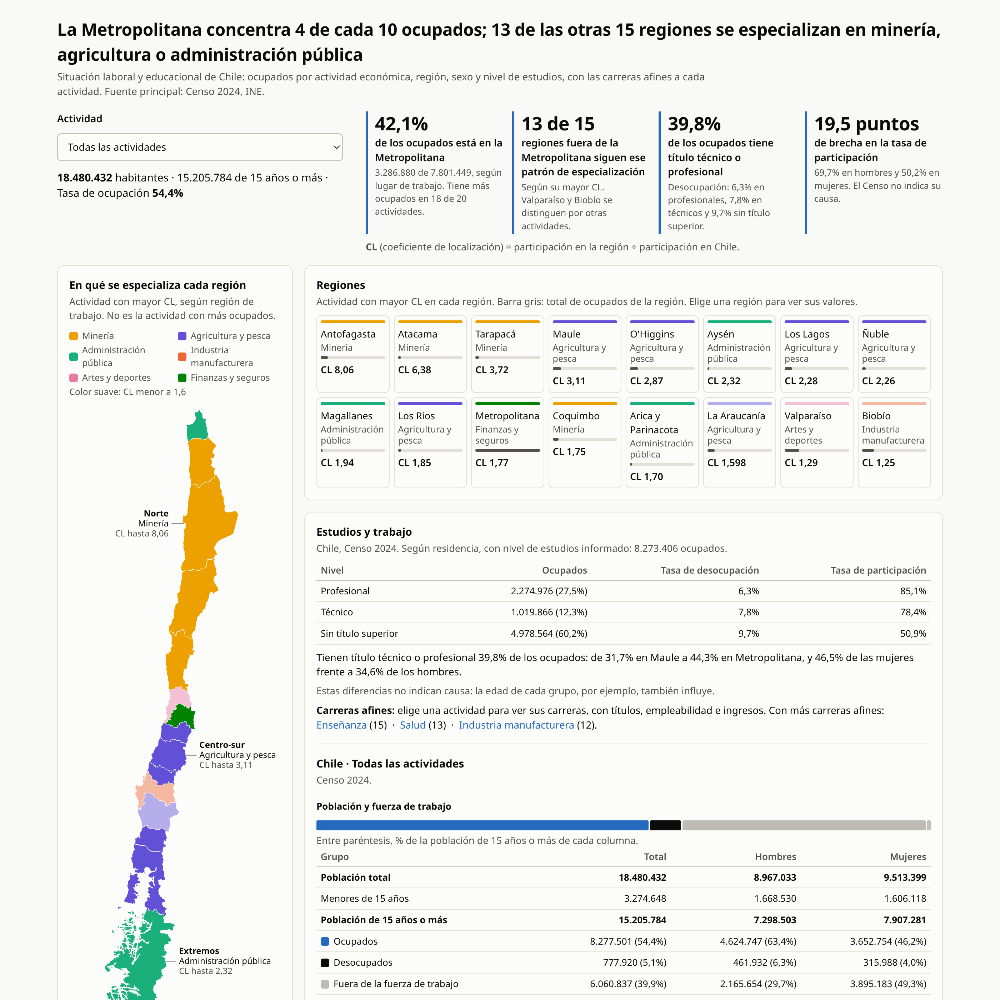

# Mapa Laboral de Chile

> Mapa interactivo para conocer la situación laboral y educacional de Chile: dónde se concentra cada actividad económica, cómo se distribuye el trabajo por sexo y nivel de estudios, y qué carreras están más ligadas a cada actividad, usando solo datos medidos en fuentes oficiales.

La vista inicial resume cuántas personas trabajan en Chile, las 20 actividades y lo que distingue a cada región. Luego eliges una actividad, como Minería o Salud, y el mapa colorea cada región según su coeficiente de localización (CL), que compara la participación de esa actividad en la región con la de Chile. Al hacer clic en una región ves sus cifras por sexo y nivel de estudios, y las carreras afines a nivel nacional, cada una con su ficha de titulados, empleabilidad e ingresos.

**Para verlo:** descarga [`index.html`](src/Visualizacion/Mapa_Actividades/Salida/index.html) y ábrelo en el navegador. Es un solo archivo de 291 KB, sin servidor ni dependencias.



*Vista inicial: el resumen de la población y las 20 actividades. Cada región tiene el color de la actividad con mayor coeficiente de localización (CL), y un color más suave indica un CL menor a 1,6.*

## Qué permite ver

- **Un CL alto no significa más ocupados.** En Industria manufacturera, la Metropolitana tiene más ocupados (276.233), pero el mayor CL está en Biobío (1,25, con 59.327). El mapa muestra ambas lecturas.
- **Una actividad puede estar muy concentrada.** Minería tiene un CL de 8,06 en Antofagasta, con 101.929 ocupados.
- **El trabajo cambia según el nivel de estudios y el sexo.** La tasa de desocupación del Censo es 6,3% en profesionales, 7,8% en técnicos y 9,7% en quienes no tienen título superior. La tasa de participación es 69,7% en hombres y 50,2% en mujeres. El mapa no atribuye causas a estas diferencias.
- **Una carrera se conecta con una actividad, no con una región.** Las carreras afines se presentan como dato nacional, porque ninguna fuente permite medirlas por región con solidez.

## La decisión que definió el proyecto

El proyecto empezó como un cálculo de probabilidad de empleo por carrera y región, y luego pasó a un Índice de Cupos. Ambos se descartaron al comprobar que **carrera × región no es medible**: de 3.040 combinaciones, solo 62 pasaban el filtro de fiabilidad en ocupados y 0 en desocupados. Un reparto sintético habría dado una cifra para cada combinación, pero suponiendo la misma mezcla de carreras en todas las regiones.

Se eligió mostrar menos, pero medido. Cada dato conserva su fuente y lo nacional se rotula como nacional. El trabajo retirado sigue disponible en la etiqueta de git `indice-cupos`.

## Fuentes

| Fuente | Institución | Aporta | Alcance |
|---|---|---|---|
| Censo 2024 | INE | Capa principal: ocupados por actividad y región de trabajo (15,2 millones de personas de 15 años o más) | Regional |
| Encuesta Nacional de Empleo (ENE), dic. 2025 a sep. 2026 | INE | Contraste del censo; sus cifras no se mezclan con las de él | Regional |
| CASEN 2024 | Ministerio de Desarrollo Social y Familia | Único vínculo entre carrera y actividad económica | Nacional |
| Titulados 2007-2025 (SIES) | Mineduc | Titulados por carrera | Nacional |
| Buscador de Empleabilidad e Ingresos (MiFuturo) | Mineduc | Empleabilidad e ingresos por carrera | Nacional |

## Cómo se validó

Cada paso se detiene si falla uno de sus controles. Estas comprobaciones se repitieron en un clon limpio del repositorio el 03-11-26:

- **Reproducibilidad:** la cadena completa, desde los datos crudos, genera un `index.html` idéntico byte a byte.
- **Contra el dato oficial:** el procesamiento de ENE reproduce el Boletín INE n°336 (julio-septiembre de 2026), con una desviación máxima de 0,08%.

| Indicador | INE | Este proyecto | Desviación |
|---|---:|---:|---:|
| Fuerza de trabajo | 10.282.718 | 10.282.930 | +0,00% |
| Ocupadas | 9.274.742 | 9.275.130 | +0,00% |
| Desocupadas | 1.007.976 | 1.007.799 | −0,02% |
| Inactivas | 6.416.440 | 6.421.373 | +0,08% |
| Ocupadas informales | 2.451.443 | 2.452.190 | +0,03% |
| Tasa de desocupación | 9,8% | 9,80% | exacta |

- **Entre fuentes:** el CL del censo y el de ENE tienen una correlación de 0,95 en las 209 combinaciones de región y actividad que ENE mide con fiabilidad. Sus tamaños sí difieren en seis actividades, y el mapa lo avisa.
- **Coherencia del mapa:** color y cifra se calculan una sola vez, con el valor sin redondear. La generación se detiene si el color y la lectura se contradicen.

## Criterios principales

Son criterios de trabajo, no estándares oficiales.

- **Encuestas (ENE y CASEN):** un dato es fiable con n ≥ 60, gl ≥ 9 y CV ≤ 30, con errores calculados según el diseño muestral (linealización de Taylor).
- **Coeficiente de localización (CL):** participación de la actividad en la región ÷ participación en Chile. Una región queda sobre Chile desde 1,2, y bajo Chile hasta 0,8. No se lee con menos de 60 personas.
- **Carrera afín:** al menos 10% de sus ocupados en la actividad, al menos el doble de lo normal entre titulados y un dato fiable. Si la muestra es insuficiente pero hay 10 casos o más, se muestra como posible vínculo.

## Límites

- **No mide demanda, vacantes ni probabilidad de encontrar trabajo.** Ninguna fuente mide demanda por carrera.
- **Afinidad no es ejercer la profesión:** indica dónde trabajan los titulados, no qué tareas realizan.
- **Censo y ENE difieren** en tamaño de seis actividades y en desempleo (profesionales: 6,3% y 8,1%). **La causa no está comprobada.**
- **Región de trabajo:** 5,8% de los ocupados del censo no la tiene, sobre todo quienes trabajan en varias comunas. Por eso Transporte, Construcción y Electricidad aparecen bajo su tamaño.
- **Los ingresos de MiFuturo no muestran una evolución:** el 1er y el 5° año vienen de generaciones distintas.
- **Rapa Nui y Juan Fernández no se dibujan,** pero sus datos siguen en Valparaíso.

La explicación completa de cada dato está en la [nota de lectura](src/Visualizacion/Mapa_Actividades/Salida/nota_de_lectura.md).

## Cómo reproducirlo

Probado con Python 3.13 en Linux.

```bash
python3 -m venv .venv
.venv/bin/pip install pandas==2.3.3 numpy==2.3.5 pyarrow==26.0.0 geopandas==1.2.0 shapely==2.2.0 \
  requests==2.32.5 beautifulsoup4==4.15.0 rapidfuzz==3.12.2 openpyxl==3.1.5
```

Los datos crudos no están en el repositorio porque pesan hasta 1,6 GB. Para regenerar el mapa hay dos caminos:

**Solo el mapa.** Las tablas intermedias ya están versionadas, así que basta con la capa de regiones. La descarga pesa 795 MB, puede tardar varios minutos (19 en la prueba) y el script borra el zip al terminar:

```bash
.venv/bin/python -W ignore src/Scrapers/CENSO/obtener_cartografia.py
.venv/bin/python -W ignore src/Visualizacion/Mapa_Actividades/generar_mapa.py
```

**La cadena completa.** El procesamiento tarda unos 10 minutos con los datos ya descargados:

```bash
PY=.venv/bin/python
export PYTHONWARNINGS=ignore

# 1. Descargar y procesar las fuentes
for f in Titulados Empleabilidad ENE CASEN CENSO; do
  $PY src/Scrapers/$f/obtener.py
  $PY src/Scrapers/$f/procesar.py
done

# 2. Puentes entre fuentes
for p in P1_puente_actividades P5_puente_carrera_casen P6_control_no_asignados P9_perfil_laboral_carrera; do
  $PY src/Analisis/Puentes_de_mapeo/$p.py
done

# 3. Tablas del mapa, en este orden
$PY src/Analisis/Calculos_control/ocupados_region_actividad/crosswalk.py
for t in Concentracion_Region_Actividad Concentracion_Region_Actividad_Censo Areas_Por_Actividad Carreras_Por_Actividad Fuerza_Trabajo_Region_Nivel; do
  $PY src/Analisis/JOINS/$t/crosswalk.py
done

# 4. Mapa
$PY src/Scrapers/CENSO/obtener_cartografia.py
$PY src/Visualizacion/Mapa_Actividades/generar_mapa.py
```

Los pasos de `procesar.py` en adelante y `obtener_cartografia.py` se probaron en un clon limpio. Las descargas con `obtener.py` no se repitieron en esa prueba, y dependen de que los sitios oficiales mantengan sus páginas y enlaces.

## Estructura

```text
Datos/datos_externos/glosarios/   Libros de códigos y metodologías oficiales
src/Scrapers/                     Descarga y limpieza de cada fuente (Entrada/ → Salida/)
src/Analisis/Puentes_de_mapeo/    Cruces entre fuentes: actividades y carreras
src/Analisis/Calculos_control/    Control de la tabla regional de ENE
src/Analisis/JOINS/               Tablas que alimentan el mapa
src/Visualizacion/Mapa_Actividades/  Generador, plantilla y mapa final
pizarra/                          Estado, decisiones y bitácora del proyecto
```

Cada tabla va acompañada de un reporte `_inspeccion.txt`, generado por `src/Scrapers/comun/inspect_data.py`. El detalle de cada archivo está en [`pizarra/Estructura.md`](pizarra/Estructura.md).

**Tecnologías:** Python, pandas, GeoPandas, Shapely, requests y BeautifulSoup para los datos. HTML, CSS, JavaScript y SVG para el mapa, sin bibliotecas externas.

## Estado

El mapa está generado y validado en sus datos. La revisión de uso con mouse y teclado la confirmó el autor el 04-11-26.
